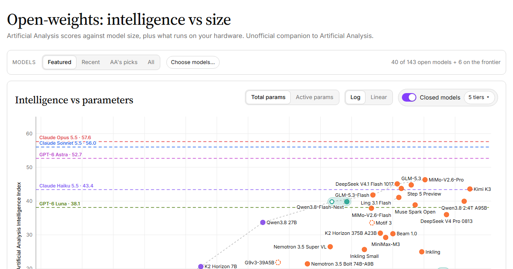

# Open-weights: intelligence vs size

**Live site: https://mr-september.github.io/artificial-analysis-weights/**

[](https://mr-september.github.io/artificial-analysis-weights/)

[Artificial Analysis](https://artificialanalysis.ai/) scores open-weights models on its Intelligence Index, but its charts plot intelligence against price and speed, not size. This site plots the index against **parameter count** (total or active) for every open-weights model it scores, and adds a "What should I run?" guide: say how much VRAM, RAM or unified memory you have and which precision you want, and it shows which models fit, how they are placed, and how they trade off coding against knowledge and speed. Useful if you want to run an LLM locally and need to know what your hardware can take.

Unofficial. Not affiliated with or endorsed by Artificial Analysis or Hugging Face.

## Reading the charts

- **Main chart.** Intelligence Index against total or active parameters, log or linear. The dashed line is the frontier: no smaller model scores higher. Frontier models are always shown, whichever model set you pick. A MoE's *active* parameters set its speed, its *total* parameters set its memory.
- **Lookup-table models** (n-gram or per-layer embedding tables, such as Qwen3.8-Flash-Next) appear as two linked points: the ring is the size without the tables, the filled dot the full size. The tables take memory but almost no bandwidth, so they can sit on SSD. The frontier uses the ring.
- **Closed models.** They publish no sizes, so the optional "Closed models" switch draws the latest model of each product tier at the leading closed labs as dashed score lines.
- **What should I run?** Weights fill VRAM, then system RAM, then SSD if you allow it. A model counts as usable if a bandwidth estimate gives it a few tokens per second; the estimate is rough and not shown. On RTX 5000 / Blackwell, "4-bit" means NVFP4, elsewhere GGUF Q4_K_M. Artificial Analysis scored hosted endpoints, so quantized local copies will score lower.
- **Quadrant.** Horizontal: coding and agentic percentile minus knowledge and instruction-following percentile (Artificial Analysis has no creative-writing eval). Vertical: speed, approximated by fewer active parameters. Dot size: Intelligence Index. A ring marks models that nothing beats on both speed and intelligence.

## Where the data comes from

| What | Source |
|---|---|
| Scores, release dates, total and active parameters, model-picker defaults | Artificial Analysis leaderboard and model pages |
| Exact total sizes, stored sizes, repos, licenses | Hugging Face (safetensors headers); AA's figure is kept where the two differ by more than 8%, with a note |
| Lookup-table sizes, the Featured set | Hand-curated: `data/overrides.json`, `data/curated.json` |
| Hardware capacities and bandwidths | Rough representative values in `assets/hardware.js` |

A GitHub Action refreshes `data/` every three days and redeploys. It refuses to publish if a scrape returns under 80% of the previous model count, and its log lists recent open models that are not in the Featured set.

## Corrections and curation

- Wrong parameter count or missing lookup-table size: edit `data/overrides.json` (keyed by Artificial Analysis family id, for example `qwen3-8-flash-next`).
- Featured set and picker order: edit `data/curated.json`.
- Hardware numbers: `assets/hardware.js`. Fit logic: `assets/core.js`.

Pull requests welcome.

## Development

No build step; it is a static site with stdlib-only Python for the data refresh.

```
python scripts/update.py        # refresh data (optional)
python -m http.server 8000      # then open http://localhost:8000
```

Open these via the local server; each prints PASS or FAIL:

- `tests/core.test.html`: fit and placement maths
- `tests/ui.test.html`: interactions
- `tests/responsive.test.html`: no overflow from 320 to 2560 px

```
index.html, assets/          the site (core.js: fit logic, hardware.js: presets, app.js: UI)
data/                        models.json (generated), curated.json and overrides.json (hand-edited), caches
scripts/                     scrape_aa.py, hf.py, update.py
.github/workflows/pages.yml  refresh and deploy
```

## Credits and license

Benchmark data belongs to [Artificial Analysis](https://artificialanalysis.ai/); sizes and model metadata come from [Hugging Face](https://huggingface.co/). Please credit them if you reuse it, and follow their terms. The code and hand-curated files in this repository are MIT licensed (see `LICENSE`).
